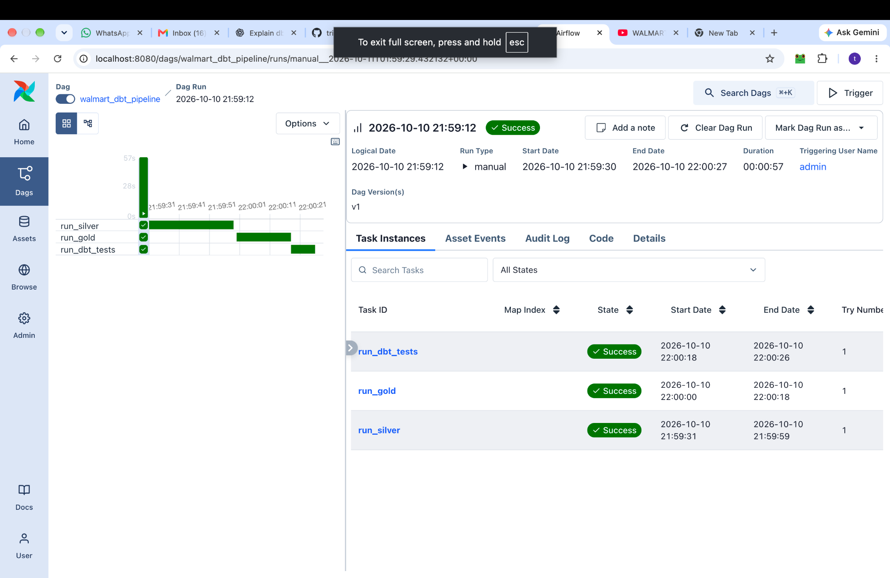

# Walmart Data Engineering Pipeline

## Project Overview

This project demonstrates an end-to-end data engineering pipeline using Databricks, dbt, Apache Airflow, Python, and SQL.

The pipeline follows a Medallion Architecture with Bronze, Silver, and Gold layers to transform raw Walmart-related data into structured datasets for analytics.

## Technologies Used

- Databricks
- Apache Spark
- dbt (Data Build Tool)
- Apache Airflow
- Python
- SQL
- PostgreSQL
- Git and GitHub

## Data Pipeline Architecture

**Bronze → Silver → Gold → Data Quality Testing**

### Bronze Layer
Stores raw source data in Databricks.

### Silver Layer
Uses dbt staging models to prepare customer, employee, order, and order-item datasets for downstream transformations.

### Gold Layer
Uses dbt models to create analytics-ready data, including the `fct_order_sales` fact table.

## Airflow Orchestration

Apache Airflow orchestrates the dbt workflow using three tasks:

1. `run_silver` — Execute Silver staging models.
2. `run_gold` — Build the Gold fact model.
3. `run_dbt_tests` — Execute dbt data quality tests.

The tasks execute sequentially to ensure that transformations finish before validation.

## Project Structure

- `walmart_dbt/models/silver/` — Silver staging models
- `walmart_dbt/models/Gold/` — Gold transformation models
- `walmart_dbt/airflow/` — Airflow DAG
- `walmart_dbt/tests/` — dbt testing directory
- `scripts/` — Python database connectivity scripts

## Project Validation

The Airflow DAG was executed successfully, with the Silver, Gold, and dbt testing tasks completing.

## Future Improvements

- Add pipeline architecture diagrams.
- Include Airflow and Databricks execution screenshots.
- Expand automated data quality tests.
- Add CI/CD validation for dbt models.

## Airflow Pipeline Execution

The Airflow DAG successfully executed all three tasks:

- `run_silver`
- `run_gold`
- `run_dbt_tests`

